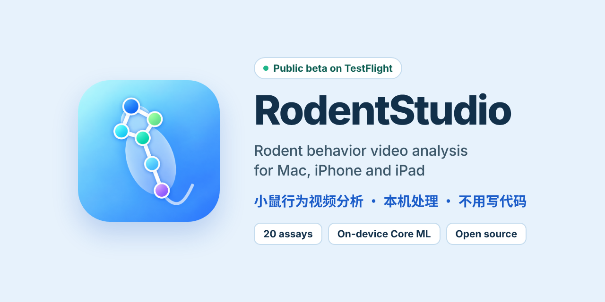

<p align="center">
  
</p>

<p align="center">
  <a href="https://testflight.apple.com/join/dU24jGY7"></a>
  
  
  
  <a href="source/macOS/RodentStudio-0.7.1/LICENSE"></a>
</p>

<p align="center">
  <a href="https://seesaw-earth.github.io/RodentFlow/"><b>Website</b></a> ·
  <a href="https://seesaw-earth.github.io/RodentFlow/guide/editions.html"><b>User guide</b></a> ·
  <a href="https://testflight.apple.com/join/dU24jGY7"><b>Join the beta</b></a> ·
  <a href="https://seesaw-earth.github.io/RodentFlow/support.html"><b>Support</b></a> ·
  <a href="README.zh-CN.md"><b>简体中文</b></a>
</p>

---

> [!NOTE]
> **The website has moved to <https://seesaw-earth.github.io/RodentFlow/>.** The pages of this repository now redirect there, and the user guide, FAQ, support and privacy pages are part of the RodentFlow manual. The source code stays here, in [`source/`](source/).

**RodentFlow** analyses your own videos of laboratory rodents on your own device. Import a video, calibrate the arena, run tracking, review the result and export structured data — no code, no Python, no account and no upload. The Core ML models ship inside the app.

## 🧪 Public beta on TestFlight

The Mac app is open for public testing.

1. Install Apple's free **TestFlight** app from the Mac App Store.
2. Open the invite on your Mac: **<https://testflight.apple.com/join/dU24jGY7>**, then choose **Accept** and **Install**.
3. Try it on your own recordings and use **Send Beta Feedback** in TestFlight, or [open an issue](https://github.com/seesaw-earth/RodentStudio-Support/issues/new/choose).

> Beta builds can be unstable. Keep backups of your original videos and exported data.

## How it works

| Step | What you do |
| --- | --- |
| **1 · Import** | Drag in MP4 / MOV files. Animal ID and date are read from the file name. |
| **2 · Calibrate** | Drag handles onto the arena and enter its real size in cm. |
| **3 · Track** | On-device Core ML pose models or classic centroid tracking; videos queue and run in turn. |
| **4 · Review & export** | Spot-check 100 frames, flag bad frames, then export tables, figures and a methods note. |

## 20 behavioral assays

| Family | Method | Assays |
| --- | --- | --- |
| **RodentPose** | Core ML pose, 6 keypoints · Mac, iPhone, iPad | Open Field · Elevated Plus Maze · Light–Dark Box · Novel Object Recognition · Three-Chamber Sociability · Social Interaction Test · Dyadic Social Interaction · Y-Maze Spontaneous Alternation · T-Maze VTE · Barnes Maze · Fear Conditioning · Looming-Evoked Escape · Rotational Behavior · Head Direction · Spatial Exploration / Place Cells · *Pose data only* |
| **RodentLimb** | Core ML limb pose, 7 keypoints · Mac | Cylinder test · Tail suspension (single mouse) · Gait |
| **RodentFlow** | Classic centroid tracking, 10 Hz · Mac | Morris Water Maze · Conditioned Place Preference · plus position-based versions of Open Field, Elevated Plus Maze, Light–Dark Box, Y-Maze, T-Maze, Novel Object Recognition, Barnes Maze and Fear Conditioning |
| **TST multi-chamber** | Chamber detection + per-chamber motion · Mac | Several mice scored side by side from one tail-suspension recording |

Full calibration and metric details: [Assay reference](https://seesaw-earth.github.io/RodentFlow/assays/pose.html).

## Built for results you can defend

- **Frame-by-frame review** — check 100 frames in under a minute, flag tracking errors and record a verdict.
- **Track once, score many times** — change zones, thresholds or the analysis window without re-running the model.
- **n = animals** — repeated sessions are averaged per animal before group statistics, never pooled by frame.
- **Compare groups** — Welch t, ANOVA, mixed ANOVA and non-parametric tests built in (Mac), for a first look at your data.
- **Analysis-ready exports** — English-column CSVs plus `README_methods.txt`, ready for R, Python, Prism or Excel; DeepLabCut-style frame data.

## 🔒 Privacy

- No account and no upload: videos, tracking and results stay on your Mac, iPhone or iPad.
- No ads and no developer-run analytics.
- Original videos are read in place and never modified.

Details: [Privacy policy](https://seesaw-earth.github.io/RodentFlow/privacy.html).

## Requirements

| | RodentFlow for Mac | RodentFlow Mobile |
| --- | --- | --- |
| **System** | macOS 14 Sonoma or later (Apple silicon recommended) | iOS / iPadOS 17 or later |
| **Best for** | Whole studies: many animals, groups, repeated sessions, statistics and bulk export | Quick single-video analysis at the bench, teaching |
| **Status** | Public beta on TestFlight | Preparing for release |

## What's in this repository

```text
├── index.html, guide.html, …   Support website, served by GitHub Pages
├── zh/                          Chinese pages
├── assets/                      Icons, stylesheet, banner
├── source/                      Swift / SwiftUI source for Mac and iPhone / iPad
│   ├── macOS/RodentStudio-0.7.1/
│   └── iOS/RodentStudio-Mobile-iOS/
├── MAINTAINING.md               How the website is deployed and kept accurate
├── PUBLISHING_CHECKLIST_CN.md   App Store publishing checklist (Chinese)
└── APP_STORE_CONNECT_URLS.md    URLs used in App Store Connect
```

### Build from source

Open the `.xcodeproj` for your platform in Xcode, pick your own development team for signing, and build. Core ML models are stored with **Git LFS** — run `git lfs pull` after cloning. See [source/README.md](source/README.md) and [Building from source](https://seesaw-earth.github.io/RodentFlow/guide/editions.html#build).

## Support

Questions and bug reports go to [Issues](https://github.com/seesaw-earth/RodentStudio-Support/issues/new/choose). Include the app version, macOS / iOS version, Mac chip, module and steps to reproduce. **Issues are public — never attach confidential research videos or personal data.**

## License

The app source code in [`source/`](source/) is released under the **GNU AGPL-3.0** — see each project's `LICENSE`; third-party and model notes are in the project folders (for example [THIRD_PARTY_NOTICES.md](source/iOS/RodentStudio-Mobile-iOS/THIRD_PARTY_NOTICES.md)). © 2026 Ziqing Shi.

> **Research note:** RodentFlow is a research aid, not a diagnostic tool. Its metrics are algorithmic estimates; validate them against manual scoring on your own setup before drawing scientific conclusions.
